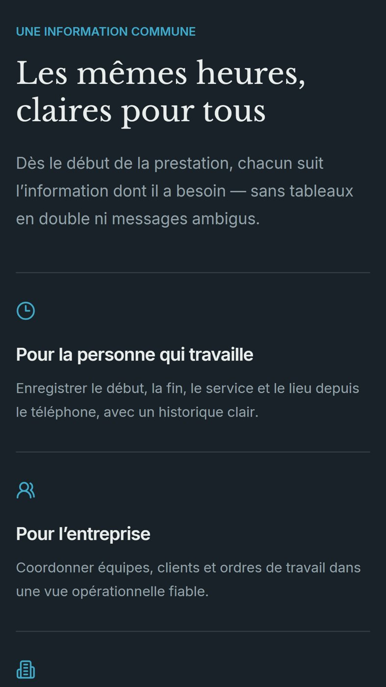
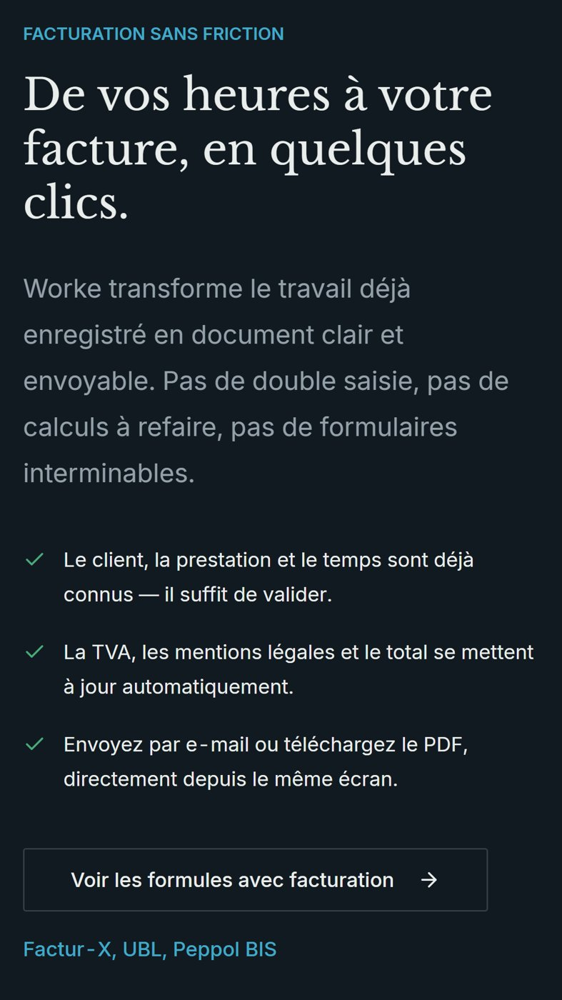

# Worke

Time tracking, work orders and invoicing for field service teams. Each worker logs start, end, service and site from the phone; the company sees the activity and turns it into an invoice.

**[worke.app](https://worke.app)** · Web, iOS and Android

## What it does

- Workers clock in and out with service and site, from their phone
- Managers coordinate teams, clients and work orders in one view
- Logged hours become an invoice with VAT and legal mentions filled in, sent by e-mail or as a PDF
- E-invoicing formats: Factur-X, UBL, Peppol BIS

## Built with

TypeScript, React, Supabase, Capacitor.

The source code is private. This repository only holds the presentation.

---
A product of [Depozza SAS](https://depozza.com).
